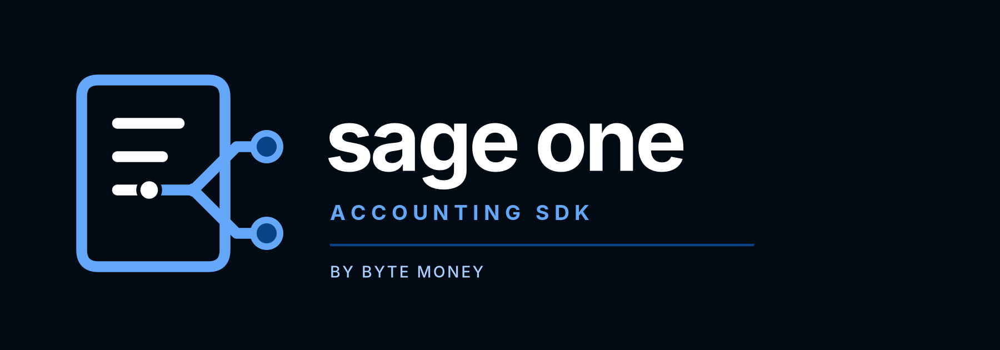

<!-- Project branding -->

  

<h1 align="center">@bytemoney/sage-one</h1>

  A strongly typed TypeScript SDK for the Sage One Accounting API in South Africa.
   
  Build accounting integrations with typed resources, runtime validation and a consistent client interface.

  
  
  
  

  <a href="#what-is-it">What is it?</a> ·
  <a href="./docs/guide/README.md">Guide</a> ·
  <a href="#api-coverage">API coverage</a> ·
  <a href="#quick-example">Example</a> ·
  <a href="#development">Development</a> ·
  <a href="#documentation">Documentation</a>

---

> [!IMPORTANT]
> **Beta software — not yet a 1.0 production release.** The implementation currently covers all 622 discovered API operations across 162 services. M007, the production-readiness and 1.0 release milestone, is the next project phase. Review the [roadmap](./milestones/roadmap.md) and [known limitations](./docs/api/known-limitations.md) before adopting it for critical workloads.

## What is it?

**@bytemoney/sage-one** is a TypeScript SDK for the **Sage One Accounting API 2.0.0 (South Africa)**.

It provides a typed, validated interface to Sage One's accounting and business-management services. Rather than making every integrating application hand-roll HTTP requests, interpret untyped JSON, manage authentication and reconstruct pagination, the SDK centralises those concerns behind a coherent client and domain-oriented API.

The project is developed by **Byte Money** and is independent of Sage. It is not an official Sage product and is not affiliated with, endorsed by or sponsored by The Sage Group plc.

## Why this SDK?

Accounting integrations deserve more than a thin collection of HTTP wrappers. They need predictable contracts, explicit behaviour and careful treatment of financial data.

| Capability | What it provides |
|---|---|
| **Strong TypeScript contracts** | Typed resources, request models, response models and accounting-domain types |
| **Runtime validation** | Zod schemas validate request and response boundaries |
| **Authentication** | Dedicated authentication and session-management interfaces |
| **HTTP transport** | Native Fetch transport with configurable behaviour, timeouts, conservative retries and a central per-company request scheduler (`Retry-After`, concurrency, pacing) |
| **OData queries** | Typed query construction, filtering, ordering and pagination |
| **Financial safety** | Financial mutations are not automatically retried by default |
| **Structured logging** | Pluggable logging with sensitive-value redaction |
| **Consistent errors** | A structured error hierarchy that preserves useful API context |
| **Attachments and batch operations** | Support for file attachments and API batch workflows |

The design aims to preserve Sage's API semantics rather than silently normalising wire-level values. In particular, field names, identifiers, dates, enumerations and monetary values must retain their meaning across the SDK boundary.

## API coverage

  <strong>162 services</strong> &nbsp;·&nbsp;
  <strong>622 operations</strong> &nbsp;·&nbsp;
  <strong>100% implemented</strong>

The M006 implementation and verification work covers the complete discovered API surface:

| Verification dimension | Coverage |
|---|---:|
| Discovered services | 162 |
| Discovered operations | 622 |
| Implemented operations | **622 / 622** |
| Fully typed operations | **622 / 622** |
| Zod-validated operations | **622 / 622** |
| Contract-tested operations | **622 / 622** |

Coverage spans the principal accounting and business domains:

- Financial accounting and general ledger
- Customers, sales and receivables
- Suppliers, purchases and payables
- Banking and cash movement
- Inventory and item management
- Taxation and VAT reporting
- Fixed assets
- CRM and company administration
- Time tracking
- Supporting, document and reporting services

The API documentation itself is not uniformly complete: the coverage catalogue records 552 fully documented, 56 partially documented, 8 experimental and 6 without model documentation. These distinctions are retained in the [coverage matrix](./docs/api/coverage-matrix.md), rather than being hidden behind the implementation-coverage figure.

**Explore:** [Detailed API coverage matrix](./docs/api/coverage-matrix.md) · [Known API limitations](./docs/api/known-limitations.md)

## Quick example

The public client is designed around domain services and typed OData queries.

~~~typescript
import { type Account, odata, SageOneClient } from "@bytemoney/sage-one";

const sage = new SageOneClient({
  credentials: {
    username: process.env.SAGE_USERNAME!,
    password: process.env.SAGE_PASSWORD!,
  },
  apiKey: process.env.SAGE_API_KEY!,
  companyId: 12345,
});

const accounts = await sage.accounts.list({
  odata: odata<Account>()
    .filter("Active", "eq", true)
    .orderBy("Name", "asc")
    .top(50),
});
~~~

Credentials and API keys should be supplied through your application's secret-management mechanism. Do not hard-code them or commit them to source control.

### Package availability

The project is currently in beta and progressing through its production-readiness milestone. The package is not advertised here as a published npm release. Follow the repository for release announcements and installation guidance as the release process is finalised.

## Requirements

- Node.js **24 or later**
- pnpm, pinned through the project's package manager configuration
- Nix is recommended for the reproducible development environment

## Development

Clone the repository and enter the reproducible development shell:

~~~bash
git clone https://github.com/zharia/sage-one-accounting-api.git
cd sage-one-accounting-api

nix develop
pnpm install
pnpm verify
~~~

### Useful commands

| Command | Purpose |
|---|---|
| `pnpm build` | Compile ESM output, declaration files and source maps |
| `pnpm test` | Run unit, integration and contract tests |
| `pnpm typecheck` | Run strict TypeScript checks |
| `pnpm lint` | Run ESLint |
| `pnpm format` | Format the codebase with Prettier |
| `pnpm verify` | Run the comprehensive verification suite |
| `pnpm discover:models` | Discover missing model and enum documentation |
| `pnpm generate:domains` | Regenerate domain modules and the client from the endpoint catalogue |

CI runs the verification workflow on pushes and pull requests to `main`. It validates the Nix flake, installs from the frozen lockfile, runs the full verification suite, and separately tests the supported Node.js engine matrix.

## Project structure

| Path | Responsibility |
|---|---|
| `src/` | SDK client, transport, authentication, validation, types and domain services |
| `contracts/` | Archived Sage API contract snapshots, fixtures and endpoint catalogue |
| `tests/` | Unit, integration, contract, type, property and opt-in live tests |
| `docs/` | Architecture, API, integration and development documentation |
| `milestones/` | Project roadmap, milestone and sprint specifications |
| `scripts/` | API discovery, generation, contract validation and verification tooling |

## Documentation

### Guide — start here

- [What is it?](./docs/guide/what-is-it.md) — the SDK, its provenance and how it was built
- [Who is it for?](./docs/guide/who-its-for.md) — audiences, fit and non-fit
- [How it works](./docs/guide/how-it-works.md) — architecture and the life of a request
- [Why use it?](./docs/guide/why-use-it.md) — the case over hand-rolled HTTP

### Reference

- [Documentation index](./docs/README.md)
- [Architecture overview](./docs/architecture/overview.md)
- [API coverage matrix](./docs/api/coverage-matrix.md)
- [Known API limitations](./docs/api/known-limitations.md)
- [Development environment](./docs/development/environment-setup.md)
- [Architectural decisions](./docs/decisions/decision-index.md)
- [Milestone roadmap](./milestones/roadmap.md)
- [Agent and contributor instructions](./AGENTS.md)
- [Project specification](./__init_spec_01.md)

## Roadmap

The project has completed its foundation, API discovery, core infrastructure, foundational accounting and commercial transaction milestones:

- **M001–M006:** accepted; full discovered endpoint implementation completed.
- **M007:** next — production readiness, documentation and package verification, release automation and the 1.0 release.

See the [milestone roadmap](./milestones/roadmap.md) for dependencies, scope and current status.

## Contributing

Issues, defect reports and technical discussion are welcome. Before proposing a change, consult the [project specification](./__init_spec_01.md), [architecture documentation](./docs/architecture/overview.md) and [milestone roadmap](./milestones/roadmap.md) so contributions remain aligned with the project's accepted design.

Please use synthetic data in tests and issue reports. Never submit credentials, live API secrets or production financial data.

## Security

Please report vulnerabilities privately through [GitHub Security Advisories](https://github.com/zharia/sage-one-accounting-api/security/advisories/new). Do not disclose security vulnerabilities in public issues.

See [SECURITY.md](./SECURITY.md) for the full policy.

## Licence

Licensed under the [Apache License 2.0](./LICENSE). See [NOTICE](./NOTICE) for third-party and trademark notices.

**Sage**, **Sage One** and related marks are trademarks of The Sage Group plc or its licensors. This SDK uses those names solely to identify the API with which it is designed to work. It is an independent project and is not affiliated with, endorsed by or sponsored by Sage.

---

  Built with care by <a href="https://github.com/zharia">Byte Money</a> · Money, Bytes and Africa.
   
  <a href="https://github.com/zharia/sage-one-accounting-api">Repository</a> · <a href="https://accounting.sageone.co.za/api/2.0.0/help">Sage One API reference</a> · <a href="https://github.com/zharia/sage-one-accounting-api/issues">Issues</a>

